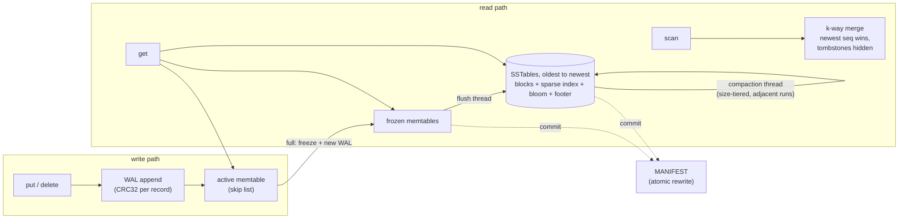

# lsm-tree-kv

[](https://github.com/rahulkumar96t/lsm-tree-kv/actions/workflows/ci.yml)

An embeddable log-structured merge-tree (LSM) key-value storage engine for Java 21, written from
scratch with no runtime dependencies. Writes go to a checksummed write-ahead log and a concurrent
skip-list memtable; full memtables are flushed in the background to immutable SSTables (sorted
data blocks, sparse index, bloom filter, checksummed footer) and merged by size-tiered compaction.
It is a learning-grade but carefully tested engine: crash recovery, newest-wins merging and
tombstone garbage collection are covered by unit, crash and randomized model tests.

## Features

- **Write-ahead log** with a CRC32 per record; recovery tolerates a torn or corrupt last record
  (or refuses to open, in strict mode).
- **Memtable** on `ConcurrentSkipListMap`: lock-free reads, size-based flush to SSTables on a
  background thread, write stalls as backpressure when flushing falls behind.
- **SSTables**: 4 KiB data blocks with CRC32, sparse block index, per-table bloom filter
  (~1% false positives at 10 bits/key), meta block and a 64-byte footer that checksums everything.
- **Deletes** via tombstones that carry their deletion time.
- **Point gets and range scans**; scans use a k-way merge iterator where the highest sequence
  number wins.
- **Size-tiered compaction** in the background that drops shadowed versions and expired
  tombstones, without ever resurrecting deleted data.
- **Manifest** rewritten atomically (temp file, fsync, rename) so a crash never leaves a
  half-updated catalogue; leftover files from interrupted flushes are cleaned up on open.
- **REPL/CLI** (`java -jar`), a statistics API and a small benchmark main.

## Architecture



| Package | Responsibility |
| --- | --- |
| `lsm` | `LsmTree` (engine, recovery, flush/compaction scheduling), options, stats |
| `lsm.wal` | write-ahead log format, append, replay |
| `lsm.memtable` | skip-list memtable |
| `lsm.sstable` | SSTable writer/reader, bloom filter, footer, meta block |
| `lsm.internal` | versioned `Entry`, k-way `MergingIterator` |
| `lsm.compaction` | size-tiered run selection |
| `lsm.manifest` | durable list of live tables + recovery watermarks |
| `lsm.cli`, `lsm.bench` | REPL and benchmark mains |

### On-disk layout

```
000007.wal      write-ahead log of the active memtable
000012.sst      immutable sorted table
MANIFEST        live tables (oldest first), next file number, last flushed sequence number
LOCK            prevents two processes from opening the directory
```

WAL record: `crc32 | length | type | seq | keyLen | key | valueLen | value` (the CRC covers the
length too, so a corrupted length is detected rather than trusted).

SSTable: `[data blocks][index block][bloom block][meta block][footer]`. Every data block ends
with its CRC32; the footer stores offset, length and CRC32 of the index, bloom and meta blocks,
a format version, a magic number and its own CRC32.

## Quickstart

Requires JDK 21+. The Maven wrapper downloads Maven itself.

```bash
./mvnw verify                      # build, check formatting, run all tests
./mvnw -q package -DskipTests
java -jar target/lsm-tree-kv-0.1.0-SNAPSHOT.jar ./data
```

```
lsm> put user:1 alice
OK
lsm> put user:2 "bob smith"
OK
lsm> del user:1
OK
lsm> scan
user:2 = bob smith
(1 keys)
lsm> flush
OK
lsm> stats
last sequence        3
memtable bytes       0
frozen memtables     0
sstables             1 [225]
sstable bytes        225
sstable entries      2
...
```

Commands: `put`, `get`, `del`, `scan [from] [to] [limit]`, `flush`, `compact`, `stats`, `help`,
`quit`. Commands can also be piped in on stdin.

## Using the library

```java
LsmOptions options = LsmOptions.builder()
    .memtableFlushBytes(8 << 20)
    .syncWrites(false)                       // true = fsync the WAL on every write
    .tombstoneRetention(Duration.ofHours(1))
    .build();

// import static io.github.rahulkumar96t.lsm.util.Bytes.utf8;  (String -> UTF-8 bytes)
try (LsmTree db = LsmTree.open(Path.of("data"), options)) {
  db.put(utf8("user:42"), utf8("{\"name\":\"Ada\"}"));
  Optional<byte[]> value = db.get(utf8("user:42"));
  db.delete(utf8("user:42"));

  // prefix scan: every key starting with "user:" (';' is the byte after ':')
  try (CloseableIterator<KeyValue> it = db.scan(utf8("user:"), utf8("user;"))) {
    while (it.hasNext()) {
      KeyValue kv = it.next();
      // keys arrive in unsigned lexicographic order, one live version per key
    }
  }
  db.flush();    // memtable -> SSTable; afterwards nothing depends on the WAL
  db.compact();  // merge all SSTables into one
}
```

## Design decisions and trade-offs

- **Every record carries a sequence number.** Merging (scans and compaction) picks the highest
  sequence number per key, so correctness never depends on the order sources are handed to the
  merge iterator.
- **Size-tiered compaction over adjacent tables only.** Classic STCS buckets tables by size
  regardless of age. Restricting tiers to neighbours keeps the table list ordered by age with
  disjoint sequence ranges. That buys two things: a point lookup can stop at the first table that
  has the key, and a tombstone can be dropped exactly when the compaction includes the oldest
  table (nothing older could still hold a value it shadows) and its retention has passed. The cost
  is occasionally waiting longer for a tier to form.
- **Idempotent WAL replay.** The manifest records the highest sequence number already in
  SSTables. Replay skips records at or below it, so a WAL that outlived its flush (a crash between
  committing the manifest and deleting the log) cannot resurrect overwritten values. There is a
  test for exactly this window.
- **Recovery flushes replayed data immediately** and deletes the old logs. Simple and robust; the
  price is a small extra SSTable after a crash, which compaction absorbs.
- **Reference-counted SSTables.** Readers pin the tables of the current version with a CAS
  increment instead of a lock; compaction swaps the version and the replaced files are deleted only
  when the last reader (for example an open scan) releases them.
- **Interrupt safety.** A `FileChannel` closes itself when a thread blocked on it is interrupted.
  The WAL therefore writes through `FileOutputStream`, and SSTable readers reopen the channel if
  another thread's interrupt closed it.
- **Failure model.** A failed WAL append or background flush/compaction makes the engine
  read-only; reopening recovers from the WAL. Durability: with `syncWrites=false` (default) an
  acknowledged write survives a process crash (the WAL is unbuffered, so the bytes are in the OS
  page cache) but not power loss; `syncWrites=true` fsyncs every write.
- **Memtable keeps only the latest version per key.** Simple and memory-efficient, but it means
  there are no snapshots: a scan sees a stable set of SSTables and frozen memtables, yet is weakly
  consistent with concurrent writes to the active memtable.
- **Fixed-width encoding, no compression.** Easy to read and verify; files are larger than with
  varints, key prefix compression or block compression.

## Testing

`./mvnw verify` runs 73 tests (JUnit 6, AssertJ) plus a google-java-format check; no external
services are needed.

- **Component tests**: WAL, memtable, SSTable writer/reader (multi-block round trips, bounds,
  corrupted blocks/footers, truncation, reference counting, a reader interrupted mid-read),
  bloom filter (no false negatives, false-positive rate), merge iterator, compaction policy,
  manifest, CLI.
- **Crash-recovery tests** (`CrashRecoveryTest`): a package-private `simulateCrash()` stops the
  engine without flushing or cleaning up; tests then truncate the WAL tail, flip bytes in the last
  record, restore a stale WAL, plant orphan table/temp files, crash repeatedly during recovery, and
  crash at random points while flushes and compactions run in the background.
- **Randomized model test** (`RandomizedModelTest`): 8 seeds x 4,000 random operations (put,
  delete, get, range scan, flush, compaction, clean reopen, crash + reopen) compared against
  `java.util.TreeMap`, with tiny memtables/blocks and randomized options so flushes, multi-block
  tables and background compactions happen constantly. Keys use bytes such as `0x7f`/`0x80`/`0xff`
  to catch signed-ordering bugs.

As a sanity check during development, deliberately reversing the newest-wins comparator,
disabling the WAL sequence-number skip, or dropping tombstones without the oldest-table rule each
made the suite fail.

## Benchmark

`LsmBenchmark` is a single-threaded, single-shot main (no JMH, no warm-up iterations), so treat
the numbers as order-of-magnitude indications. Measured on an Apple M4 Pro (12 cores, 24 GB RAM,
internal SSD, macOS), OpenJDK 21.0.11, default options (4 MiB memtable, `syncWrites=false`),
1,000,000 keys of 13 bytes with 100-byte values; range over three runs:

```bash
./mvnw -q compile
java -cp target/classes io.github.rahulkumar96t.lsm.bench.LsmBenchmark 1000000 100
```

| Workload | Throughput |
| --- | --- |
| sequential insert (incl. final flush) | 239k–250k ops/s |
| random overwrite (incl. final flush) | 224k–229k ops/s |
| random get, key present | 308k–331k ops/s |
| random get, key absent (bloom filter path) | 1.40M–1.58M ops/s |
| full scan | 6.2M–7.2M keys/s |

Writing 2M records of ~113 bytes produced ~650 MB of compaction output for ~150 MB of final
tables, i.e. the write amplification you would expect from size-tiered compaction without key
prefix compression.

## Limitations and roadmap

- No block cache (relies on the OS page cache) and no block compression or key prefix compression.
- No snapshots / MVCC reads and no atomic multi-key write batches.
- One flush thread and one compaction thread; compaction writes a single output table instead of
  splitting it, and there is no leveled compaction option.
- No group commit: with `syncWrites=true` every write pays its own fsync.
- WAL replay reads each log fully into memory (bounded by the memtable size).
- Keys up to 64 KiB, values up to 64 MiB.
